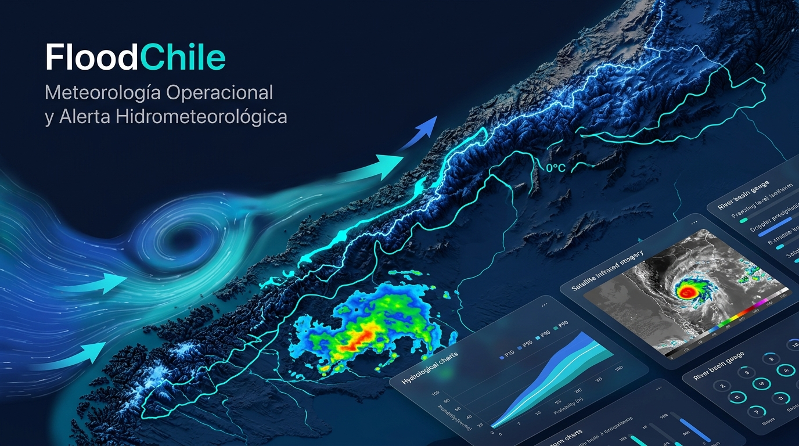
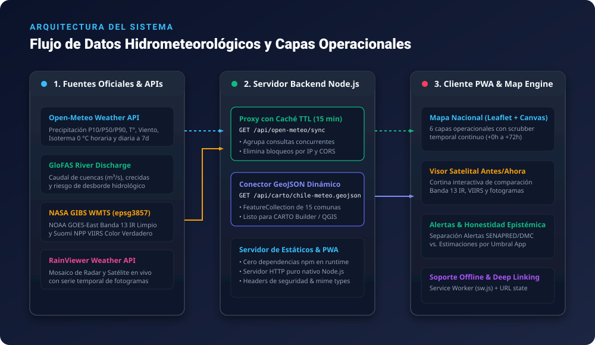
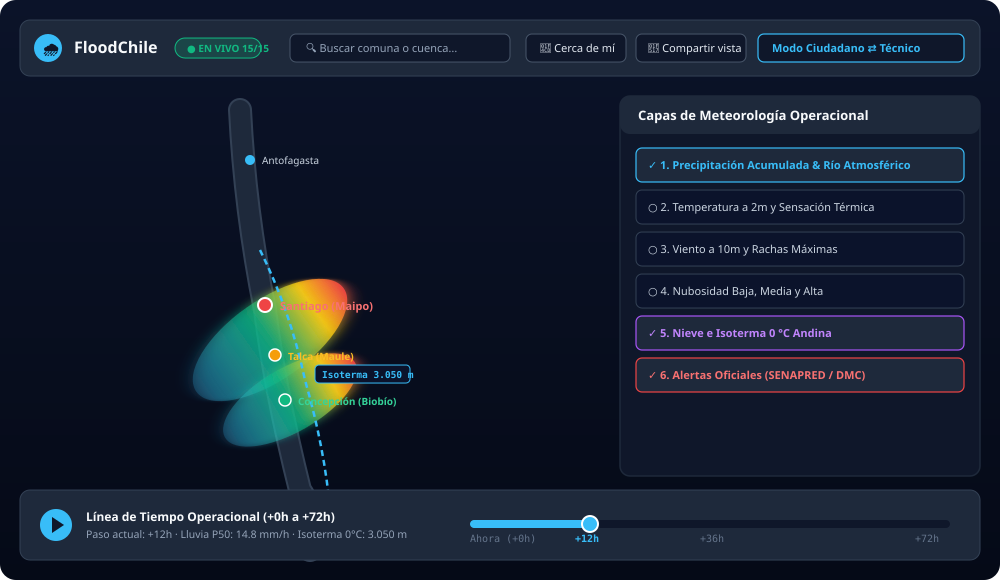
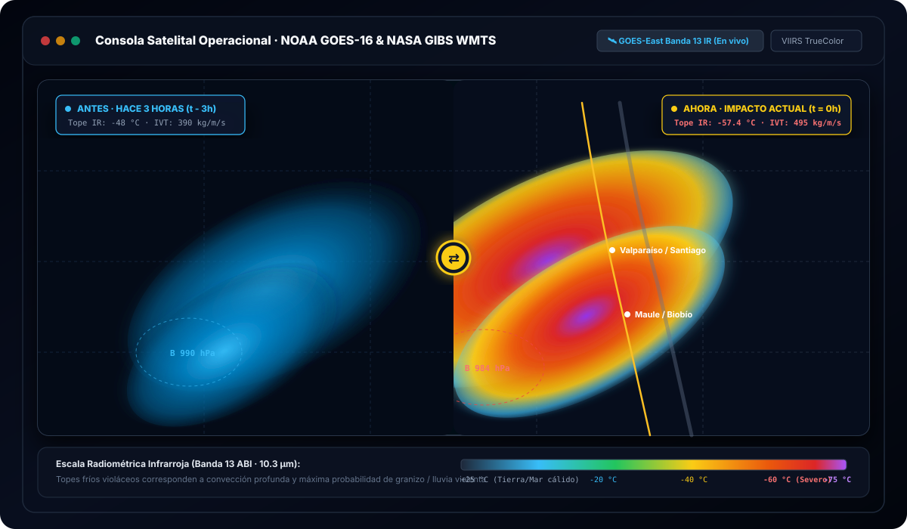
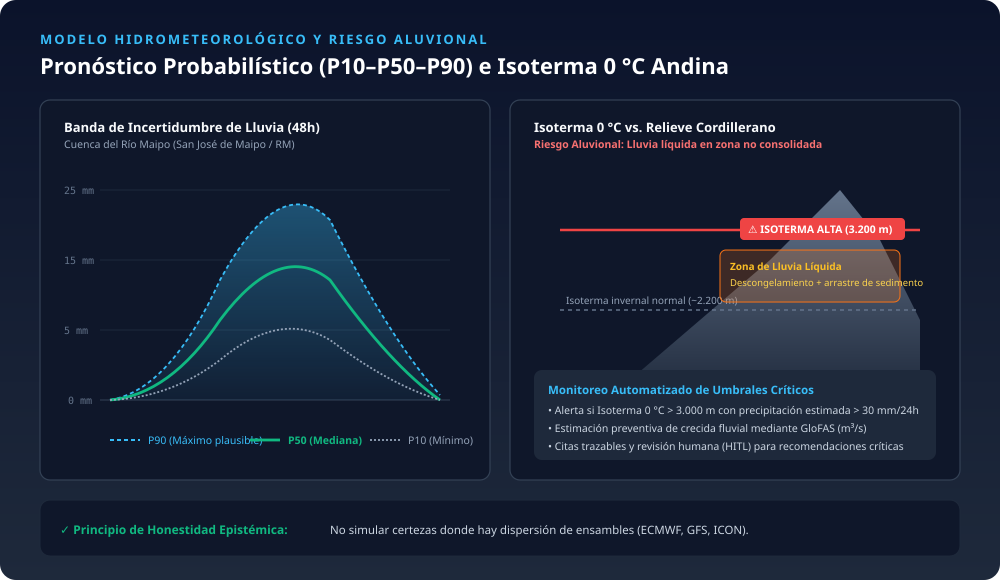

# FloodChile (ClimasFlood) 🇨🇱🌧️

<p align="center">
  
</p>

<p align="center">
  <strong>Plataforma abierta de meteorología operacional, pronóstico hidrometeorológico externo y escenarios de referencia, monitoreo de isoterma 0 °C y anticipación de riesgos aluvionales para las 16 regiones de Chile.</strong>
</p>

<p align="center">
  <a href="./LICENSE"></a>
  <a href="https://nodejs.org/">= 18" /></a>
  <a href="#pruebas-y-verificaci%C3%B3n"></a>
  <a href="#pwa-offline"></a>
</p>

---

## 📋 Tabla de Contenidos

1. [¿Qué incorpora este paquete?](#-qué-incorpora-este-paquete)
2. [Componentes y Módulos Descriptivos](#-componentes-y-módulos-descriptivos)
   - [1. Arquitectura del Sistema y Flujo de Datos](#1-arquitectura-del-sistema-y-flujo-de-datos)
   - [2. Mapa Nacional Multicapa y Línea de Tiempo](#2-mapa-nacional-multicapa-y-línea-de-tiempo)
   - [3. Visor Satelital Antes / Ahora con NASA GIBS](#3-visor-satelital-antes--ahora-con-nasa-gibs)
   - [4. Modelo Hidrometeorológico e Isoterma 0 °C Andina](#4-modelo-hidrometeorológico-e-isoterma-0-c-andina)
3. [Pasos para Instalar y Ejecutar](#-pasos-para-instalar-y-ejecutar)
   - [Requisitos previos](#requisitos-previos)
   - [Paso 1: Clonar el repositorio](#paso-1-clonar-el-repositorio)
   - [Paso 2: Instalación de dependencias](#paso-2-instalación-de-dependencias)
   - [Paso 3: Iniciar el servidor local](#paso-3-iniciar-el-servidor-local)
   - [Paso 4: Verificación de pruebas (CA-01 a CA-09)](#paso-4-verificación-de-pruebas-ca-01-a-ca-09)
   - [Paso 5: Variables de entorno y configuración](#paso-5-variables-de-entorno-y-configuración)
   - [Paso 6: Despliegue en producción (PM2 / Docker / Systemd)](#paso-6-despliegue-en-producción-pm2--docker--systemd)
4. [Endpoints de la API](#-endpoints-de-la-api)
5. [Estructura del Proyecto](#-estructura-del-proyecto)
6. [Honestidad Epistémica y Criterios de Aceptación](#-honestidad-epistémica-y-criterios-de-aceptación)
7. [Licencia](#-licencia)

---

## 🌟 ¿Qué incorpora este paquete?

FloodChile fue diseñado para superar la brecha entre pronósticos meteorológicos genéricos y la toma de decisiones ante desastres naturales en Chile (ríos atmosféricos, aluviones con isoterma 0 °C alta, inundaciones ribereñas e impactos costeros):

- **Sincronización automática en vivo (15 comunas de referencia)**: Conecta directamente con **Open-Meteo Weather API**, **GloFAS River Discharge API** y **Open-Meteo Marine API** al iniciar y cada 30 minutos.
- **Proxy con caché TTL (15 minutos)**: Reduce latencia, evita bloqueos por cuotas de IP y permite el funcionamiento en red local o institucional.
- **Conector GeoJSON para CARTO Builder / QGIS**: Endpoint dinámico `GET /api/carto/chile-meteo.geojson` listo para conectarse a plataformas GIS en la nube.
- **Imágenes Satelitales Reales**: Integración con **NASA Earthdata GIBS WMTS** (NOAA GOES-East Banda 13 Infrarrojo Limpio y Suomi NPP VIIRS Color Verdadero) junto a mosaicos de **RainViewer (Radar + IR)**.
- **Línea de tiempo operativa (+0h a +72h)**: Reproducción horaria de lluvia acumulada, viento, temperatura, nieve y evolución de frentes fríos.
- **Buscador de comunas y cuencas hidrográficas**: Autocompletado instantáneo por nombre de comuna, región o cuenca.
- **Herramientas de terreno**: Botón **📍 Cerca de mí** (geolocalización local sin enviar coordenadas a terceros) y **🔗 Compartir vista** con *deep linking* (`?loc=&capa=&h=&vista=`).
- **Resiliencia ante catástrofes (PWA Offline)**: *Service Worker* (`sw.js`) con estrategia *Network-First + Cache Fallback* para seguir consultando mapas y pronósticos si se cae la red móvil durante el temporal.

---

## 🖼 Componentes y Módulos Descriptivos

### 1. Arquitectura del Sistema y Flujo de Datos

El sistema desacopla la ingesta de APIs abiertas internacionales, el procesamiento en caché del backend y la renderización en el navegador:

<p align="center">
  
</p>

- **Fuentes externas**: Ingesta simultánea de modelos meteorológicos globales (ECMWF, GFS, ICON), hidrología fluvial (GloFAS) y satélites geoestacionarios (GOES-16).
- **Backend Node.js nativo**: Servidor HTTP liviano sin librerías pesadas externas, con caché en memoria (`serverLocationSyncTimestamps`) y servidor GeoJSON.
- **Frontend PWA**: Motor Leaflet con capas Canvas personalizadas, optimización de marcadores sin reconstrucción de DOM y diseño responsivo.

---

### 2. Mapa Nacional Multicapa y Línea de Tiempo

La interfaz central ofrece 6 capas operacionales diseñadas para emergencias hidrometeorológicas:

<p align="center">
  
</p>

1. **Precipitación Acumulada**: Tasas horarias (mm/h) y acumulados en 24h/48h/72h.
2. **Temperatura y Sensación Térmica**: Temperaturas a 2 m del suelo en tiempo real.
3. **Viento y Rachas Máximas**: Vectores de viento a 10 m y ráfagas estimadas.
4. **Nubosidad**: Cobertura nubosa desglosada en estratos bajos, medios y altos.
5. **Nieve e Isoterma 0 °C Andina**: Cota en metros sobre el nivel del mar donde la precipitación pasa de nieve a lluvia líquida.
6. **Alertas Oficiales**: Visualización de zonas bajo alerta temprana preventiva o alerta roja de SENAPRED / DMC.

---

### 3. Visor Satelital Antes / Ahora con NASA GIBS

Permite a meteorólogos y analistas de emergencias comparar el avance del frente frío en las últimas horas:

<p align="center">
  
</p>

- **Cortina Interactiva (⇄)**: Deslizador táctil y por ratón que compara el fotograma previo con el actual.
- **Topes Convectivos Infrarrojos**: Detección de nubes frías severas (temperaturas de brillo de hasta -70 °C asociadas a granizo y lluvia torrencial).
- **Selector de Fuentes Satelitales**:
  - `NASA GIBS · GOES-East Banda 13 IR`: Mosaico satelital infrarrojo limpio en tiempo real.
  - `RainViewer · Radar / IR`: Radar meteorológico y nubosidad en vivo.
  - `NASA GIBS · VIIRS Color Verdadero`: Imagen satelital en luz visible y reflectancia.

---

### 4. Modelo Hidrometeorológico e Isoterma 0 °C Andina

Chile presenta alta vulnerabilidad aluvional cuando llueve con una isoterma 0 °C anormalmente elevada en las cuencas andinas:

<p align="center">
  
</p>

- **Pronóstico y escenario de referencia**: muestra el dato de lluvia entregado por la API y un escenario superior heurístico. Este escenario no es un percentil ni un intervalo calibrado; consultar la fuente y las alertas oficiales antes de decidir.
- **Riesgo Aluvional**: Monitorea si la isoterma 0 °C supera cotas críticas (>3.000 m s.n.m. en la zona central) coincidiendo con precipitaciones líquidas abundantes sobre cuencas de tierra suelta (Maipo, Cachapoal, Maule, Biobío).

---

## 🚀 Pasos para Instalar y Ejecutar

### Requisitos previos

- **Node.js**: Versión 18.0.0 o superior (verificar con `node -v`).
- **NPM**: Incluido con Node.js (verificar con `npm -v`).
- **Git**: Para clonar el repositorio (verificar con `git --version`).
- **Navegador web moderno**: Chrome, Edge, Firefox, Safari (compatible con ES Modules y Service Workers).

> **Nota de dependencias**: Este proyecto está construido con JavaScript nativo (Node.js ES Modules en el backend y Vanilla JS en el frontend). **No requiere dependencias externas de npm en tiempo de ejecución**.

---

### Paso 1: Clonar el repositorio

Abre tu terminal y clona el proyecto desde GitHub:

```bash
git clone https://github.com/datmetalpls/FloodChile.git
cd FloodChile
```

---

### Paso 2: Instalación de dependencias

Ejecuta el comando estándar de npm:

```bash
npm install
```

*(El proyecto no descarga paquetes de terceros ya que utiliza las APIs estándar de Node.js, lo que garantiza una instalación instantánea y libre de vulnerabilidades).*

---

### Paso 3: Iniciar el servidor local

Ejecuta el script de inicio:

```bash
npm start
```

Verás una salida similar a:

```text
============================================================
  CLIMASFLOOD / FLOODCHILE - SERVIDOR LOCAL
  Plataforma de Meteorología Operacional para Chile
============================================================
✓ Servidor activo en: http://localhost:4173
✓ Feed GeoJSON CARTO:  http://localhost:4173/api/carto/chile-meteo.geojson
✓ Proxy Open-Meteo:   http://localhost:4173/api/open-meteo/sync?loc=scl-rm
✓ Modo PWA Offline:   Habilitado (manifest.json + sw.js)
============================================================
```

Abre tu navegador en: **`http://localhost:4173`**

---

### Paso 4: Verificación de pruebas (CA-01 a CA-09)

Para verificar que todos los criterios de aceptación, coherencia entre pronóstico base y escenario superior de muestra, capas y seguridad estén en orden, ejecuta:

```bash
npm test
```

Salida esperada:

```text
=== Verificando Criterios de Aceptación (CA-01 a CA-09) para ClimasFlood ===

✓ Cobertura territorial y multizona horaria de Chile verificada.
✓ 6 capas activables del Mapa Nacional y leyendas simbólicas verificadas.
✓ Secuencia de imágenes satelitales GOES-16 y metadatos de captura verificados.
✓ CA-02: Coherencia de pronóstico base y escenarios superiores de muestra verificada.
✓ CA-01 y Sección 5: Separación explícita de Alertas Oficiales vs. Estimaciones App verificada.
✓ Sección 6: Escenarios plausibles con factores de respaldo y señales de cambio verificados.
✓ CA-03: Registro de verificación histórica (Predicho vs. Observado) validado.
✓ CA-08 y CA-09: Trazabilidad 100% de citas de Agentes IA y bloqueo HITL verificados.
✓ Documentación técnica, PWA offline, proxy Open-Meteo y capas NASA GIBS verificados.

🎉 TODAS LAS PRUEBAS Y CRITERIOS DE ACEPTACIÓN PASARON EXITOSAMENTE.
```

---

### Paso 5: Variables de entorno y configuración

Puedes cambiar el puerto de escucha configurando la variable de entorno `PORT`:

```bash
# Cambiar a puerto 8080 en Linux/macOS
PORT=8080 npm start

# En Windows (PowerShell)
$env:PORT="8080"; npm start
```

---

### Paso 6: Despliegue en producción (PM2 / Docker / Systemd)

#### Opción A: Usando PM2 (Recomendado en VPS)
```bash
npm install -g pm2
pm2 start server.js --name "floodchile"
pm2 save
pm2 startup
```

#### Opción B: Usando Docker
Crea un `Dockerfile` mínimo:
```dockerfile
FROM node:18-alpine
WORKDIR /app
COPY . .
EXPOSE 4173
CMD ["node", "server.js"]
```
Y ejecuta:
```bash
docker build -t floodchile .
docker run -d -p 4173:4173 --name floodchile-app floodchile
```

---

## 🌐 Endpoints de la API

| Método | Ruta | Descripción |
|---|---|---|
| `GET` | `/` | Aplicación Web Principal (PWA) |
| `GET` | `/manifest.json` | Manifiesto PWA para instalación móvil y de escritorio |
| `GET` | `/sw.js` | Service Worker para funcionamiento sin conexión |
| `GET` | `/api/open-meteo/sync?loc=<id>` | Proxy con caché en memoria (15 min TTL) para pronósticos de Open-Meteo, GloFAS y Marine API |
| `GET` | `/api/carto/chile-meteo.geojson` | GeoJSON FeatureCollection con las 15 comunas sincronizadas en vivo, listo para CARTO Builder o QGIS |

---

## 📂 Estructura del Proyecto

```text
FloodChile/
├── docs/
│   ├── images/                       # Diagramas descriptivos de arquitectura y producto
│   │   ├── architecture.svg          # Arquitectura del sistema y flujo de datos
│   │   ├── dashboard-map.svg         # Mapa operacional multicapa
│   │   ├── floodchile-banner.png     # Banner visual de la plataforma
│   │   ├── hydro-risk.svg            # Modelo hidrometeorológico e isoterma 0 °C
│   │   └── satellite-viewer.svg      # Visor satelital antes/ahora con NASA GIBS
│   └── propuesta-tecnica.md          # Especificación formal de arquitectura y principios
├── public/
│   ├── css/
│   │   └── styles.css                # Estilos responsivos con tokens de diseño accesibles
│   ├── js/
│   │   ├── app.js                    # Controlador principal, deep-linking y PWA
│   │   ├── data/
│   │   │   └── chile-data.js         # Datos de comunas, zonas horarias y modelos base
│   │   └── modules/
│   │       ├── charts.js             # Gráficos SVG de pronóstico y escenario de referencia
│   │       ├── live-api.js           # Clientes para Open-Meteo, GloFAS y Marine
│   │       ├── map-engine.js         # Motor cartográfico Leaflet con capas NASA GIBS
│   │       └── satellite-viewer.js   # Visor satelital con cortina comparativa
│   ├── index.html                    # Estructura semántica de la aplicación web
│   ├── manifest.json                 # Manifiesto de la PWA
│   └── sw.js                         # Service Worker para resiliencia offline
├── tests/
│   └── verify-criteria.js            # Suite automatizada de pruebas de aceptación
├── DESIGN.md                         # Principios de diseño e interfaz
├── LICENSE                           # Licencia MIT de libre uso
├── package.json                      # Metadatos del proyecto y scripts
├── PRODUCT.md                        # Visión y especificación del producto
├── README.md                         # Documentación principal del repositorio
└── server.js                         # Servidor Node.js nativo con proxy y GeoJSON
```

---

## 🛡 Honestidad Epistémica y Criterios de Aceptación

El proyecto se rige por 9 Criterios de Aceptación (`CA-01` a `CA-09`):
1. **CA-01**: Separación rigurosa entre Alertas Oficiales (SENAPRED / DMC / SHOA) y Estimaciones Preventivas de la App.
2. **CA-02**: Coherencia entre pronóstico base y escenario superior de muestra; no se calculan percentiles estadísticos.
3. **CA-03**: La vista histórica actual usa datos sintéticos para ilustrar métricas; la verificación con observaciones reales es una capacidad objetivo aún no implementada.
4. **CA-04**: Monitoreo de Isoterma 0 °C y caudales fluviales en cuencas críticas.
5. **CA-05**: Secuencia satelital con marcas temporales reales y trazabilidad de satélite.
6. **CA-06**: Trazabilidad completa de fuentes de datos meteorológicos y satelitales.
7. **CA-07**: Cobertura territorial completa (Continental, Magallanes/Austral y Rapa Nui).
8. **CA-08**: Citas obligatorias y fundamentadas en evidencia para cualquier recomendación de IA.
9. **CA-09**: Bloqueo *Human-in-the-Loop (HITL)* obligatorio para recomendaciones de alto impacto.

---

## 📄 Licencia

Este proyecto está distribuido bajo la licencia **MIT** — puedes usarlo, modificarlo, integrarlo en otros proyectos y distribuirlo libremente para fines comunitarios, académicos o comerciales.

Consulta el archivo [LICENSE](./LICENSE) para más detalles.
