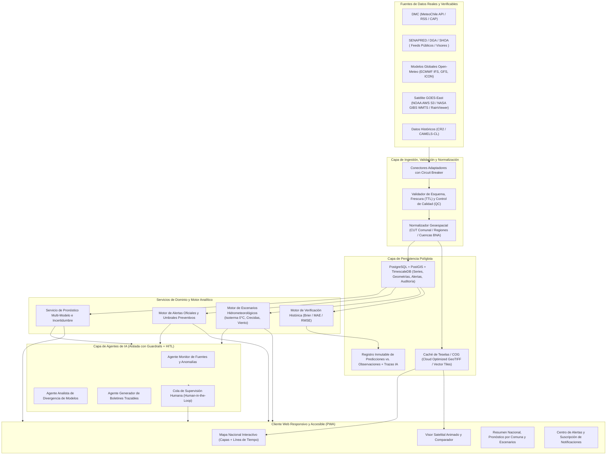
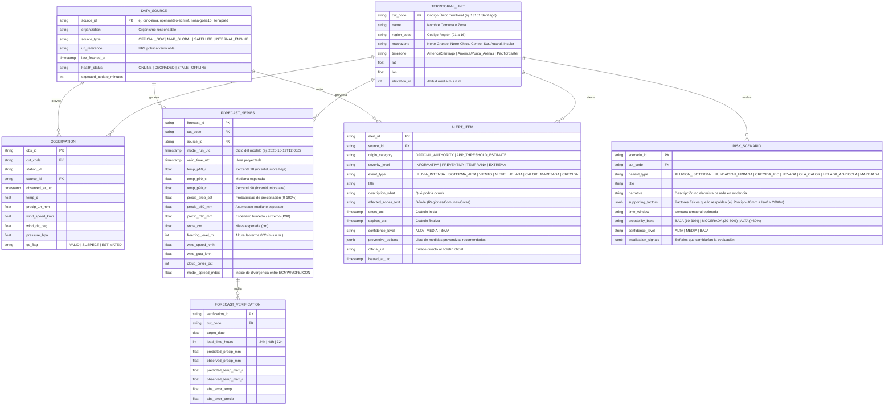
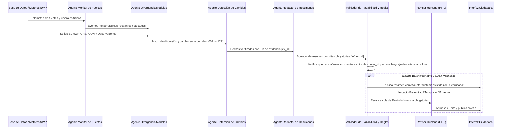

# Propuesta Técnica: Sistema Nacional de Meteorología y Anticipación de Riesgos para Chile (`ClimasFlood`)

Esta propuesta responde íntegramente a los requerimientos definidos en [prompt-app-meteorologia-chile.md](file:///Users/dmp/Desktop/proyectos/ClimasFlood/prompt-app-meteorologia-chile.md), estableciendo una base rigurosa, auditable y sin invención de APIs inexistentes para construir la plataforma nacional de monitoreo meteorológico, pronóstico y anticipación de riesgos hidrometeorológicos en Chile.

> **Estado:** documento de arquitectura objetivo. Describe capacidades planeadas; no implica que el cliente actual consulte ensambles multimodelo, calcule percentiles o ejecute los servicios descritos.

> [!IMPORTANT]
> **Principio Rector de Epistemología de Datos:** La plataforma distingue de forma estricta e inequívoca a nivel de base de datos, API y visualización entre cuatro categorías de información:
> 1. **Observación (`OBSERVATION`):** Medición instrumental real (estación meteorológica/fluviométrica o sensor satelital) con estampa de tiempo pasada.
> 2. **Pronóstico Numérico (`FORECAST`):** Salida determinista o por ensambles (EPS) de modelos numéricos de predicción (NWP como ECMWF, GFS, ICON, WRF), expresada siempre con ventana temporal e incertidumbre/rango.
> 3. **Estimación / Escenario (`SCENARIO_ESTIMATE`):** Inferencia hidrometeorológica derivada (ej. altura de isoterma 0 °C combinada con precipitación líquida en cuenca andina) presentada como escenario plausible sujeto a condiciones de cambio.
> 4. **Alerta (`OFFICIAL_ALERT` vs `INTERNAL_ADVISORY`):** Separación taxativa entre alertas legales emitidas por autoridades del Estado de Chile (DMC, SENAPRED, DGA, SHOA) y avisos preventivos calculados por umbrales en la aplicación.

---

## 1. Propuesta de Arquitectura y Componentes Principales

La arquitectura sigue un diseño **modular, orientado a eventos y preparado para agentes (Agent-Ready)**, desacoplando la adquisición de datos heterogéneos del motor de servicio geoespacial y de la interfaz de usuario.

### Componentes Principales
1. **Gateway de Ingestión Resiliente:** Conectores independientes por proveedor con control de tasa (*rate-limiting*), caché local, detección de caída o atraso de fuente (*staleness detection*) y registro de linaje (`source_id`, `fetched_at`, `valid_time`, `license`).
2. **Motor Geoespacial Chileno:** Indexación territorial basada en el **Código Único Territorial (CUT)** oficial de Chile (16 regiones, 56 provincias, 346 comunas) y zonificación bioclimática/topográfica (Costa, Valle Longitudinal, Precordillera, Cordillera, Territorio Insular y Antártico).
3. **Motor de Pronóstico Multi-Modelo e Incertidumbre:** Combina salidas deterministas y de ensambles para calcular medianas y bandas intercuartiles ($P_{10}, P_{50}, P_{90}$), evitando mostrar un único número engañoso cuando los modelos divergen.
4. **Motor de Escenarios y Riesgos Hidrometeorológicos:** Evalúa combinaciones críticas específicas de la geografía chilena (ej. **río atmosférico + isoterma 0 °C alta** sobre cuencas pluvio-nivales entre Coquimbo y Biobío; marejadas por oleaje de fondo S/SW; heladas radiativas en valles centrales; viento Puelche/Raco).
5. **Subsistema de Verificación Continua:** Almacena los pronósticos emitidos a $t - 24\text{h}, t - 48\text{h}, t - 72\text{h}, t - 120\text{h}$ y los contrasta automáticamente con las observaciones reales registradas, exponiendo métricas de desempeño por zona.
6. **Orquestador de Agentes con Guardrails:** Capa opcional y desacoplada donde agentes especializados procesan datos estructurados y generan boletines con citas obligatorias (`[ref: source_id]`), bloqueados por diseño para no alterar alertas oficiales.

---

## 2. Auditoría de Fuentes de Datos, Ingestión, Validación y Alternativas Verificables

Siguiendo la instrucción estricta de **no inventar APIs ni capacidades inexistentes**, a continuación se documenta el estado real de las fuentes en Chile, sus limitaciones técnicas y las alternativas verificables que utiliza la arquitectura:

| Dominio | Fuente Oficial en Chile | Estado Real de Acceso / Limitación Técnica | Alternativa / Integración Verificable Propuesta |
| :--- | :--- | :--- | :--- |
| **Observaciones y Avisos Meteorológicos** | **DMC (Dirección Meteorológica de Chile)** – `climatologia.meteochile.gob.cl` | La documentación vigente describe el servicio `getDatosRecientesEma/{código}` y requiere usuario/token. Las rutas antiguas de productos EMA comprobadas durante esta revisión devolvieron 404. No se validó aquí un feed CAP o de activación SAE. | El servidor consulta el endpoint documentado mediante `DMC_API_USER` y `DMC_API_TOKEN` configurados como secretos de entorno. Si faltan, reporta `NOT_CONFIGURED`; no hace llamadas a DMC ni expone credenciales al navegador. La normalización conserva tiempo de medición y hora de generación por separado. |
| **Pronóstico Numérico por Comuna y Grilla** | **DMC (Modelo WRF)** | Las salidas numéricas horarias en grilla de la DMC solo se publican como imágenes estáticas en su web; no existe API pública de consulta por coordenada con cuantiles de incertidumbre. | Uso de **Open-Meteo API** (`api.open-meteo.com/v1/forecast` y `/v1/ensemble`), 100% abierta y verificable sin API key para uso no comercial, consultando simultáneamente **ECMWF IFS (9 km)**, **NOAA GFS (25 km)** y **DWD ICON** sobre las coordenadas de las 346 comunas de Chile. Permite calcular dispersión inter-modelo real. |
| **Alertas de Emergencia y Protección Civil** | **SENAPRED** (`senapred.cl`) | La página `/alertas/` consultada entrega una aplicación JavaScript y no una lista HTML legible por el raspador. Sus páginas de comunicados pueden enlazarse; la agenda de pruebas SAE es de simulacros, no una fuente de activaciones. No se encontró feed público que permita leer Cell Broadcast desde esta app. | El scraper conserva enlaces solo cuando logra extraer publicaciones; no interpreta contenido, vigencia o zonas y no se presenta como detector SAE. Las alertas oficiales vigentes se consultan en el portal de SENAPRED. |
| **Hidrología, Caudales y Embalses** | **DGA – MOP** (Dirección General de Aguas) | La DGA informa que sus datos de estaciones en línea son provisionales y sujetos a cambios. El visor HIDROlínea está disponible al público, pero no se validó un endpoint estructurado y abierto utilizable por este servidor. | Los caudales que muestra actualmente la app provienen de Open-Meteo Flood/GloFAS y son pronóstico de modelo, no observaciones de estaciones DGA. Integrar mediciones DGA después de verificar endpoint, códigos, unidades y vigencia. |
| **Incendios forestales** | **CONAF** – informe estadístico nacional | Publica un informe HTML nacional con tablas regionales; el portal declara actualización cada 5 minutos. Es un conteo agregado reportado, no un feed geolocalizado de focos ni una alerta oficial para la app. | Conector de lectura de tabla HTML con caché local de 4 minutos, control de consistencia entre totales y regiones, sello del informe y estado de fuente. |
| **Imágenes Satelitales y Radar de Lluvia** | **DMC / GOES-16 (GOES-East)** | Chile no cuenta con una red nacional pública abierta de radares Doppler meteorológicos de cobertura continua; la observación espacial depende del satélite **NOAA GOES-16 (GOES-East)** Sector Sudamérica. | 1. **Imágenes Satelitales Reales:** Consumo directo de teselas WMTS abiertas de **NASA GIBS** (`gibs.earthdata.nasa.gov`, capas `GOES-East_ABI_Band2_Red_Visible_1km`, `Band13_Clean_Infrared`, `GeoColor`) y buckets públicos de **NOAA GOES-16 en AWS S3** (`noaa-goes16`). 2. **Secuencia Animada de Precipitación/Infrarrojo:** API pública de **RainViewer** (`api.rainviewer.com/public/weather-maps.json`) que provee mosaicos temporales animados de cobertura infrarroja satelital y precipitación estimada global con marcas de tiempo exactas. |
| **Marejadas y Alertas Costeras** | **SHOA / DIRECTEMAR** (`marejadas.shoa.cl`, `sitport.directemar.cl`) | El modelo marino de Open-Meteo está conectado; no se confirmó durante esta revisión una API pública GET de SHOA/CENDHOC consumible desde el backend. | Mantener el modelo identificado como pronóstico y los avisos como enlaces oficiales. No fusionar ambas fuentes como una observación oficial. |

### Estrategia de Validación y Actualización (Pipeline QA/QC)
1. **Frecuencia de actualización (Polling & TTL):**
   - Capas satelitales e infrarrojas: cada **10–15 minutos** (TTL máximo: 30 min).
   - Observaciones de superficie y alertas: cada **15 minutos** (TTL máximo: 45 min).
   - Pronósticos numéricos horarios/diarios (ECMWF/GFS/ICON): cada **1 a 3 horas** según ciclo sinóptico (00Z, 06Z, 12Z, 18Z; TTL máximo: 6 horas).
   - Pronósticos hidrológicos (GloFAS): cada **12–24 horas**.
2. **Reglas de Control de Calidad (QC Automático):**
   - *Rango físico plausible para Chile:* Temperatura $\in [-40\,^\circ\text{C}, +48\,^\circ\text{C}]$, Precipitación horaria $\in [0, 150\,\text{mm/h}]$, Viento $\in [0, 280\,\text{km/h}]$, Altitud de isoterma $0\,^\circ\text{C} \in [0, 6500\,\text{m s.n.m.}]$.
   - *Coherencia temporal y espacial:* Detección de saltos espurios ($>15\,^\circ\text{C}$ en 10 min en una misma estación) marcados con bandera `QC_SUSPECT`.
   - *Degradación elegante (Graceful Degradation):* Si una fuente supera su TTL sin actualizarse, el registro pasa a estado `STALE` (Desactualizado), manteniendo visible el último dato válido con un sello visual de advertencia indicando exactamente hace cuántos minutos/horas se obtuvo.

---

## 3. Modelo de Datos (Pronósticos, Observaciones, Escenarios y Alertas)

El modelo de datos garantiza trazabilidad completa (`DataProvenance`), cuantificación de incertidumbre y separación estricta entre datos oficiales e inferencias.

---

## 4. Descripción de Pantallas y Flujos Principales

La interfaz está diseñada en **español de Chile**, adaptable a dispositivos móviles (equipos en terreno) y escritorio (salas de monitoreo), cumpliendo con **WCAG 2.1 AA**:

### Principios Visuales y de Accesibilidad
- **Codificación redundante (No dependencia exclusiva del color):** Cada nivel de severidad utiliza simultáneamente **Color + Icono geométrico distintivo + Etiqueta textual + Patrón de borde**:
  - `INFORMATIVA`: Azul (`#0284c7`) + Icono círculo `ℹ` + Borde continuo fino.
  - `PREVENTIVA`: Amarillo/Ámbar (`#d97706`) + Icono rombo `◆` + Borde punteado.
  - `TEMPRANA`: Naranja (`#ea580c`) + Icono triángulo `▲` + Borde discontinuo grueso.
  - `EXTREMA`: Rojo/Violeta (`#dc2626`) + Icono octágono `🛑` + Doble borde de alto contraste.
- **Sello de Procedencia Universal (Data Badge):** Todo gráfico, tarjeta o capa incluye una píldora visible con `[TIPO: OBSERVACIÓN | PRONÓSTICO | ESTIMACIÓN | ALerta OFICIAL]`, `[Fuente]`, `[Hora de emisión en huso horario local]` y `[Estado: Vigente / Desactualizado]`.
- **Manejo Multizona Horaria de Chile:** Conversión automática y explícita entre `UTC`, `America/Santiago` (Chile Continental), `America/Punta_Arenas` (Región de Magallanes y Aysén) y `Pacific/Easter` (Rapa Nui / Isla de Pascua).

### Pantallas Principales
1. **Inicio / Resumen Nacional y Selector Territorial:**
   - Cabecera con estado de conexión a fuentes, selector rápido por **Macrozona, Región y Comuna** (o geolocalización) y selector de huso horario local.
   - Tarjetas de **Condiciones Destacadas a Nivel Nacional**: sistemas frontales activos, comunas con mayor precipitación esperada en 72 h, cota de isoterma $0\,^\circ\text{C}$ máxima, y resumen de alertas vigentes separando *Oficiales* vs *Estimaciones Preventivas de la App*.
2. **Mapa Nacional Interactivo (`Vista Geoespacial`):**
   - Mapa de Chile completo con capas conmutables: **Precipitación (mm/h y acumulado)**, **Temperatura (°C)**, **Viento (rachas km/h)**, **Nubosidad (%)**, **Nieve / Isoterma 0 °C (m s.n.m.)** y **Alertas Territoriales**.
   - Control deslizador temporal (*Time Slider*) para recorrer horas futuras y tarjeta flotante con metadatos de la capa activa (fuente, corrida del modelo, última actualización y leyenda accesible).
3. **Visor de Imágenes Satelitales y Radar Infrarrojo (`Evolución de Sistemas Frontales`):**
   - Reproductor animado de secuencia satelital/infrarroja sobre el Pacífico Sur y territorio chileno (vía NASA GIBS GOES-East / RainViewer) con controles de reproducción (`Play/Pause`, velocidad, paso a paso).
   - **Modo Comparación Antes / Ahora:** Permite contrastar un cuadro anterior ($t - 1\text{h}, t - 3\text{h}$) con la captura más reciente para visualizar la velocidad de avance de un frente o núcleo convectivo.
4. **Pronóstico de los Próximos Días y Pronóstico Detallado de Lluvia:**
   - Vista de **7 días** para la comuna o región seleccionada con rangos de temperatura ($T_{\min}..T_{\max}$ y banda de incertidumbre $P_{10}..P_{90}$), viento, nieve e isoterma $0\,^\circ\text{C}$.
   - **Módulo Especial de Lluvia:** Hietograma horario y acumulado diario que grafica tanto la mediana esperada ($P_{50}$) como el rango superior ($P_{90}$), destacando ventanas de **lluvia intensa**, **nieve** o **precipitación líquida sobre nieve (riesgo de crecida)** sin presentar las estimaciones como certezas.
5. **Centro de Alertas Tempranas, Extremas y Notificaciones:**
   - Filtro por ubicación, tipo de evento y nivel (`Informativa`, `Preventiva`, `Temprana`, `Extrema`).
   - Ficha explicativa estructurada: **¿Qué podría ocurrir?**, **¿Dónde?**, **¿Cuándo?**, **Nivel de confianza**, **Medidas preventivas recomendadas** y **Enlace directo a la fuente oficial**.
   - **Configurador de Notificaciones:** Panel para suscribir alertas por comuna, tipo de fenómeno y umbral mínimo de severidad (persistido en preferencias del usuario y listo para Web Push).
6. **Posibles Escenarios Hidrometeorológicos:**
   - Tarjetas analíticas de escenarios plausibles para los próximos días (ej. *Activación de quebradas por isoterma 0 °C alta*, *Anegamiento urbano por pulso intenso de lluvia*, *Helada matinal en valles agrícolas*, *Viento fuerte costero/cordillerano*).
   - Cada escenario detalla: **Factores de respaldo con datos actuales**, **Zonas potencialmente afectadas**, **Ventana temporal**, **Probabilidad/Confianza** y **Señales que cambiarían la evaluación** (ej. *"Si el núcleo frío ingresa 4 horas más tarde o la isoterma baja de 2.200 m, el riesgo pluvial en precordillera disminuye a nivel bajo"*).
7. **Análisis Predictivo, Divergencia de Modelos e Historial de Verificación:**
   - Comparativa explícita entre modelos numéricos (**ECMWF IFS vs. NOAA GFS vs. DWD ICON**), explicando en lenguaje sencillo qué datos sustentan la predicción y por qué existe convergencia o incertidumbre.
   - **Bitácora de Verificación Histórica:** Tabla y gráfico que comparan lo que los modelos predijeron hace 24 h / 48 h / 72 h frente a lo que realmente ocurrió en la estación/comuna, calculando el error medio absoluto (MAE) para total transparencia.
8. **Consola de Agentes IA (Modo Supervisión) + Fuentes, Metodología, Privacidad y Limitaciones:**
   - Vista del pipeline de agentes con trazabilidad por cita a los datos crudos y estado de revisión humana.
   - Documentación transparente de fuentes, licencias, metodología de cálculo, política de privacidad (geolocalización procesada sin rastreo invasivo) y limitaciones conocidas.

---

## 5. Propuesta de Agentes de IA con Límites, Trazabilidad y Supervisión

La arquitectura incorpora cuatro agentes especializados que operan bajo un esquema **Determinista Primero + IA Explicativa con Citas Obligatorias (RAG Estructurado)**:

### Catálogo de Agentes Especializados
1. **Agente Monitor de Fuentes (`SourceHealthMonitorAgent`):** Vigila latencia, caídas de endpoints (DMC, Open-Meteo, NOAA GOES, GloFAS) y anomalías de sensores (QC). Nunca inventa ni rellena datos faltantes; activa banderas de degradación y sugiere fuentes de respaldo verificables.
2. **Agente Analista de Pronósticos y Divergencia (`ForecastConvergenceAgent`):** Analiza las corridas de ECMWF, GFS e ICON. Calcula el acuerdo inter-modelo y traduce métricas estadísticas ($P_{10}, P_{50}, P_{90}$) en explicaciones comprensibles sobre la incertidumbre.
3. **Agente Detector de Cambios Relevantes (`RegimeShiftDetectorAgent`):** Compara la corrida actual del modelo con la corrida anterior ($\Delta t = -6\text{h} / -12\text{h}$) para detectar cambios bruscos (ej. aumento repentino de $+35\text{ mm}$ en precipitación proyectada o subida de $+400\text{ m}$ en la isoterma $0\,^\circ\text{C}$).
4. **Agente Generador de Resúmenes Trazables (`TraceableBriefingAgent`):** Redacta boletines ejecutivos diferenciados para ciudadanía y equipos de emergencia enlazando cada oración a un identificador de dato (`[Fuente: ECMWF 12Z | Valor: 42.5 mm]`).

### Reglas Estrictas, Límites Inquebrantables y Escalamiento (HITL)
- **Prohibición de emitir o alterar alertas oficiales:** Ningún agente tiene permisos de escritura sobre la tabla de alertas oficiales (`OFFICIAL_AUTHORITY`).
- **Prohibición de notificaciones críticas autónomas:** Los agentes no pueden disparar notificaciones de nivel `TEMPRANA` o `EXTREMA` hacia los usuarios sin la aprobación firmada de un operador humano o una regla determinista auditada.
- **Trazabilidad por afirmación (Zero-Hallucination Policy):** Todo bloque generado por un agente incluye un arreglo JSON `citations[]` que vincula cada cifra al registro exacto del modelo/observación (`source_id`, `timestamp`, `parameter`, `raw_value`). Si un validador determinista detecta una cifra sin respaldo en el payload de entrada, la salida del agente es rechazada automáticamente.
- **Lenguaje probabilístico obligatorio:** El validador bloquea frases taxativas (*"habrá inundación segura"*, *"se confirma aluvión"*) y exige formulaciones condicionales basadas en evidencia (*"los modelos estiman una probabilidad del 65% de superar los 40 mm..."*).

---

## 6. Plan de Implementación por Etapas (Roadmap)

| Etapa | Alcance Funcional | Entregables Técnicos |
| :--- | :--- | :--- |
| **Fase 1: MVP Nacional y Pronóstico Transparente** | - Mapa nacional interactivo de Chile por macrozonas/regiones/comunas con capas meteorológicas. - Visor satelital animado (GOES-East / RainViewer) con comparador Antes/Ahora. - Pronóstico a 7 días y pronóstico horario de lluvia con rangos de incertidumbre. - Distinción visual estricta entre observación, pronóstico, estimación y alerta. | Aplicación Web responsiva (ES), integración en vivo con API abierta multi-modelo (Open-Meteo ECMWF/GFS/ICON) y mosaicos satelitales reales, con respaldo determinista verificado. |
| **Fase 2: Alertas Multi-nivel y Motor de Escenarios Hidrometeorológicos** | - Sistema de alertas en 4 niveles (`Informativa`, `Preventiva`, `Temprana`, `Extrema`) accesible sin depender solo del color. - Configurador de notificaciones por comuna, evento y severidad. - Generador de escenarios plausibles (isoterma $0\,^\circ\text{C}$, crecidas, heladas, viento, marejadas) con factores de respaldo y señales de invalidación. | Motor de reglas hidrometeorológicas adaptado a la geografía chilena, diferenciación entre alertas oficiales y avisos preventivos de la app, y persistencia local de suscripciones. |
| **Fase 3: Análisis Predictivo Multi-modelo y Verificación Histórica** | - Comparador explícito entre modelos numéricos (ECMWF vs. GFS vs. ICON). - Registro de predicciones pasadas contrastadas con observaciones reales (MAE, sesgo, acierto de lluvia). | Subsistema de auditoría de pronósticos e interfaz de explicabilidad de incertidumbre y limitaciones de los modelos. |
| **Fase 4: Ecosistema de Agentes de IA con Trazabilidad y HITL** | - Agentes de monitoreo de fuentes, detección de cambios entre corridas y síntesis de boletines. - Vinculación clicable de cada frase a su dato fuente. - Flujo de revisión humana (Human-in-the-Loop) y escalamiento para eventos de alto impacto. | Consola de agentes auditable, validador de citas determinista y flujo interactivo de aprobación humana. |

---

## 7. Criterios de Aceptación Verificables

### A. Precisión y Epistemología de Datos
- [ ] **CA-01 (Separación de tipos de datos):** El 100% de las vistas (mapa, pronóstico, lluvia, alertas, escenarios) muestra una etiqueta explícita que distingue si el dato es `Observación`, `Pronóstico Numérico`, `Estimación/Escenario` o `Alerta Oficial`.
- [ ] **CA-02 (Incertidumbre obligatoria):** Todo pronóstico de lluvia y temperatura más allá de 24 horas presenta rangos ($P_{10}-P_{90}$ o banda mín/máx entre modelos) y un indicador de nivel de confianza; ninguna estimación futura se presenta como certeza absoluta.
- [ ] **CA-03 (Verificación histórica):** El módulo de Análisis Predictivo permite consultar predicciones emitidas en días previos y compararlas numérica y gráficamente contra las observaciones registradas.

### B. Actualización, Fuentes y Resiliencia
- [ ] **CA-04 (Metadatos de procedencia):** Cada capa del mapa, imagen satelital, pronóstico y alerta incluye fecha/hora de captura o corrida, huso horario local de Chile correspondiente a la ubicación, nombre de la fuente y enlace verificable.
- [ ] **CA-05 (Detección de desactualización):** Si una fuente supera su umbral de frescura (TTL) o no está disponible en línea, la interfaz señala claramente el estado `Desactualizado / Sin conexión directa` y expone la alternativa verificable sin ocultar la limitación.

### C. Accesibilidad y Experiencia de Usuario (UX)
- [ ] **CA-06 (Independencia del color):** Todos los niveles de alerta (`Informativa`, `Preventiva`, `Temprana`, `Extrema`) e intensidades de lluvia pueden identificarse en escala de grises o por lectores de pantalla mediante iconos distintos, etiquetas de texto explícitas y patrones de borde, con contraste mínimo $\ge 4.5:1$ (WCAG 2.1 AA).
- [ ] **CA-07 (Diseño responsivo en español):** La aplicación es 100% funcional en pantallas móviles (`360px` de ancho) y escritorio (`1440px+`), completamente en español y operable mediante teclado.

### D. Seguridad y Gobernanza de Agentes IA
- [ ] **CA-08 (Trazabilidad de IA):** Cada afirmación generada en el módulo de agentes exhibe una referencia verificable (`[Ref]`) que al inspeccionarse muestra el dato crudo, el modelo y la hora de emisión que la respalda.
- [ ] **CA-09 (Guardrails y supervisión humana):** Los agentes tienen bloqueada por código cualquier modificación de alertas oficiales, y toda recomendación asociada a severidad `Temprana` o `Extrema` permanece en estado `Pendiente de Revisión Humana` hasta ser aprobada explícitamente.
